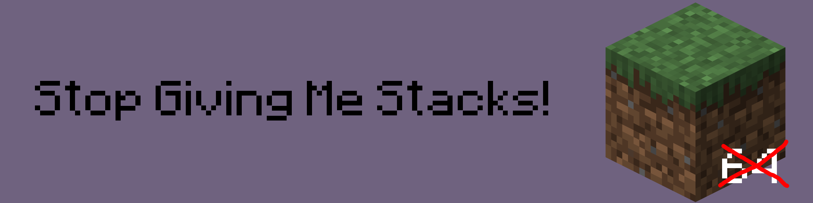

## Stop Giving Me Stacks!

SGMS is a dead-simple mod that gives you a single item instead of a full stack when pulling an item from the creative menu with a hotkey.

## Why?

It kinda bugs me seeing "64" under my items when building in creative. :/